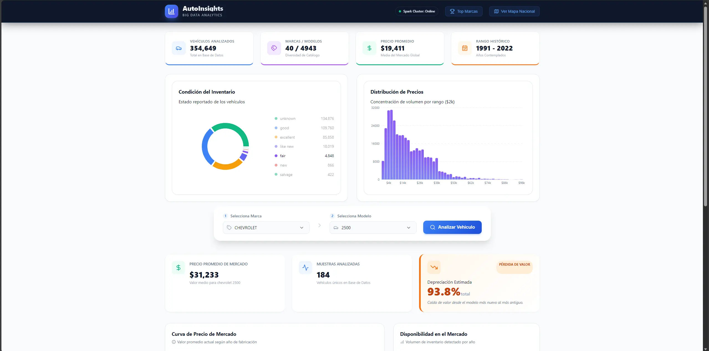
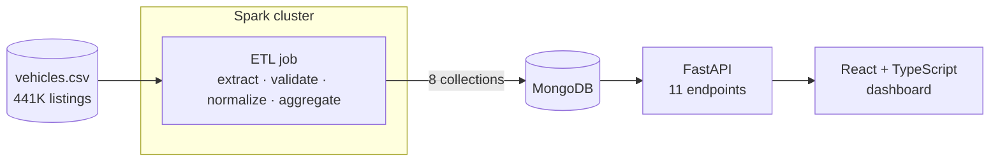

# AutoInsights

[](https://github.com/Erenriquezp/AutoInsights/actions/workflows/ci.yml)

**Used-car market analytics at scale.** A distributed Apache Spark ETL cleans and aggregates 420K+ used-car listings into MongoDB, a FastAPI service exposes the results, and a React dashboard turns them into price, depreciation, mileage and geographic insights.

> Academic team project (Big Data course, Universidad Central del Ecuador, 2026).



## Highlights

- **Distributed processing:** Spark 3.5 cluster (1 master + 2 workers) running in Docker Compose.
- **Data quality first:** explicit schema, multi-line CSV parsing, range validation and model-name normalization. **426,880 raw listings → 354,649 clean records.**
- **Pre-aggregated serving layer:** the ETL writes 8 analytics collections to MongoDB, so the API reads ready-made results instead of scanning raw data.
- **Typed dashboard:** React 19 + TypeScript with Recharts and Google Charts: KPIs, price trend, depreciation by model, price vs. mileage, condition mix, price histogram, US heat map and top brands.

## Architecture



| Layer | Tech | Where |
|---|---|---|
| Processing | Apache Spark 3.5 (PySpark), MongoDB Spark Connector | `backend/spark/jobs/etl_job.py` |
| Storage | MongoDB 6 | `docker-compose.yml` |
| API | FastAPI, PyMongo | `backend/main.py`, `backend/services.py` |
| Frontend | React 19, TypeScript, Vite, Recharts, Google Charts | `frontend/` |
| Exploration | Jupyter + PySpark | `backend/notebooks/ETL_Process.ipynb` |

## Data pipeline

1. **Extract:** reads the CSV with a predefined 26-column schema and multi-line parsing (listing descriptions contain line breaks).
2. **Validate:** keeps price $500–$1M, model years 1990–2025, odometer ≤ 500,000 and 2-letter US state codes. Corrupt rows are reported before they are filtered.
3. **Normalize:** maps free-text model names to a catalog of 16 brands, with direct mappings (`f150` → `f-150`) and regex removal of noise words (`clean title`, `4x4`, trims…).
4. **Aggregate and load:** writes average prices, the price/volume trend, mileage, market stats, condition distribution, the price histogram, geographic distribution and the top brands to MongoDB.

## API

| Endpoint | Returns |
|---|---|
| `GET /api/brands` · `GET /api/models/{brand}` | Selector metadata |
| `GET /api/market/stats` | Global market KPIs |
| `GET /api/market/trend` | Average price vs. volume per year |
| `GET /api/market/condition` | Vehicles by condition |
| `GET /api/market/histogram` | Price distribution |
| `GET /api/market/geo` | Listings by US state (heat map) |
| `GET /api/market/brands?limit=10` | Top brands by volume |
| `GET /api/vehicles/depreciation?brand=&model=` | Depreciation curve for a model |
| `GET /api/vehicles/mileage?brand=&model=` | Price vs. mileage scatter |

Interactive docs at `http://localhost:8000/docs`.

## Run it

Requirements: Docker and Docker Compose.

```bash
git clone https://github.com/Erenriquezp/AutoInsights.git
cd AutoInsights

# 1. Put the dataset at backend/data/vehicles.csv (not versioned)
# 2. Start MongoDB, the Spark cluster, the API and the dashboard
docker compose up -d --build

# 3. Run the ETL on the cluster
docker exec -it spark-master /opt/spark/bin/spark-submit /app/etl_job.py
```

| Service | URL |
|---|---|
| Dashboard | http://localhost:5173 |
| API + docs | http://localhost:8000/docs |
| Spark master UI | http://localhost:8080 |
| Spark workers | http://localhost:8081 · http://localhost:8082 |

## Data

[Used Cars Dataset](https://www.kaggle.com/datasets/austinreese/craigslist-carstrucks-data) by Austin Reese: Craigslist US vehicle listings, published on Kaggle under CC0 (public domain). Download `vehicles.csv` from Kaggle; it is not stored in this repository.

## Team

Built by Edison Enríquez, Ariel Elizalde and Mariel Milán.
