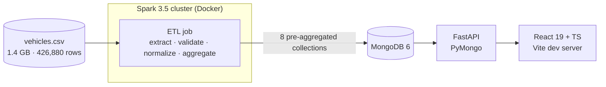
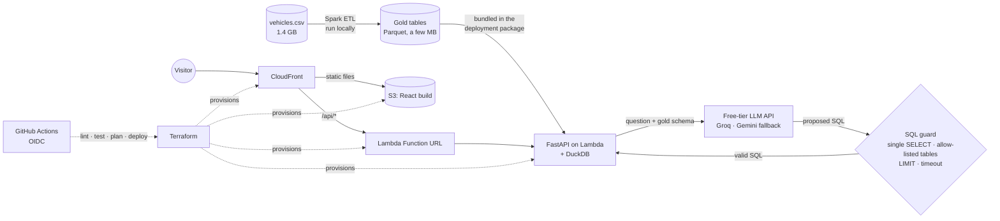

# Architecture

## v1: as built

Everything runs locally in Docker Compose.

| Component | Responsibility | Code |
|---|---|---|
| ETL | Reads the CSV with an explicit 26-column schema, filters invalid rows, normalizes model names against a 16-brand catalog, computes 8 aggregates | `backend/spark/jobs/etl_job.py` |
| MongoDB | Stores the aggregates (`precios_promedio`, `kpi_price_volume`, `kilometraje`, `estadisticas_mercado`, `distribucion_condicion`, `histograma_precios`, `distribucion_geo`, `top_brands`) | `docker-compose.yml` |
| API | Read-only endpoints over the aggregates; depreciation is computed on request | `backend/main.py`, `backend/services.py` |
| Dashboard | KPIs, price trend, depreciation, price vs. mileage, condition mix, price histogram, US map, top brands | `frontend/src/` |

**Limits of v1:** no tests or CI, unpinned dependencies, hard-coded URLs and paths, a database that
must always be running, a dev server in the frontend container, and no public deployment.

## v2: target

Design constraint: **the public demo must run at $0** on always-free allowances, and everything is
built and verified locally before it reaches the cloud.

| Change | Why | ADR |
|---|---|---|
| MongoDB -> Parquet gold tables queried with DuckDB | No database to keep running; SQL for text-to-SQL | [0001](adr/0001-parquet-duckdb-serving-layer.md) |
| Terraform for all infrastructure | Reproducible, reviewable, fully removable | [0002](adr/0002-terraform-for-infrastructure.md) |
| CloudFront + S3 + Lambda Function URL | Fits always-free allowances; no API Gateway or servers | [0003](adr/0003-serverless-hosting.md) |
| Text-to-SQL behind a validator, SQL shown in the UI | Verifiable answers; LLM output treated as untrusted | [0004](adr/0004-guarded-text-to-sql.md) |
| Spark kept for the ETL, run on demand | Distributed processing without a paid cluster | [0005](adr/0005-keep-spark-for-etl.md) |

### Request flow: "Ask the data"

1. The UI sends `POST /api/ask` with the question (length-limited, validated with Pydantic).
2. The API builds a prompt with the gold-table schema and calls the LLM through a provider interface
   (`FakeProvider` in tests and local development, a free-tier API in the cloud).
3. The SQL guard parses the answer with `sqlglot` and rejects anything that is not one `SELECT` over
   allow-listed tables with a `LIMIT`, or that calls DuckDB file, network or extension functions.
4. DuckDB runs the accepted query read-only, with a timeout.
5. The API returns the SQL, the rows and a chart suggestion. The UI always shows the SQL.

### From local to cloud

| Stage | What runs | Cost |
|---|---|---|
| Local | Docker Compose: Spark ETL, API on local Parquet, UI, `FakeProvider` or a free LLM key | $0 |
| Checks | Tests, linters, `terraform fmt`/`validate`, `tflint`, `trivy config`, `terraform plan` | $0 |
| Cloud | `terraform apply` after the local stack and the plan are approved | $0 within always-free limits |
