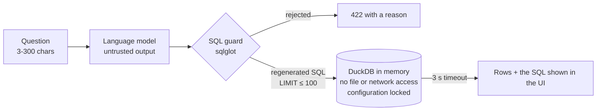

# Security

AutoInsights serves a public, read-only dataset with no user accounts. The part that needs real
care is **"Ask the data"**: a language model writes SQL from a visitor's question, and that SQL
runs on the server. This page explains how that is contained and maps the design to the
[OWASP Top 10 for LLM Applications (2025)](https://genai.owasp.org/llm-top-10/).

## Threat model

| Asset | Risk if lost |
|---|---|
| The server's files and environment (keys for the LLM provider, AWS credentials) | High |
| Availability and cost of the API and the LLM free tier | Medium |
| The gold tables | Low: public data, regenerated from the CSV |

Attacker: anyone on the internet, sending any text as a question, including prompt-injection
attempts that make the model write harmful SQL.

## Two independent layers between the model and the data

**1. SQL guard** (`backend/ask/guard.py`, 100 % branch coverage). The model's reply is parsed
with `sqlglot`, and the SQL is accepted only if:

- it is exactly **one** statement, and it is a `SELECT` (or a `UNION` of selects): `DROP`,
  `INSERT`, `UPDATE`, `DELETE`, `CREATE`, `COPY`, `ATTACH`, `INSTALL`, `LOAD`, `PRAGMA`
  and `SET` are rejected, and so is `SELECT ... INTO`;
- every table is one of the eight **allow-listed gold tables** (or a CTE defined in the same
  query), with no schema or database prefix. Table functions such as `read_csv`,
  `read_parquet`, `glob`, `range` or `duckdb_settings()` are rejected, and so are string paths
  like `FROM '/etc/passwd'`;
- every function is ordinary SQL or on a short **allow-list**: `read_text`, `read_blob`,
  `getenv`, `current_setting` and any unknown function are rejected;
- it has no parameters, and its `LIMIT`, if any, is a whole number. A missing `LIMIT` is added
  and a larger one is capped at **100 rows**.

The SQL that runs is **regenerated from the parse tree**, never the model's original text.

**2. A locked-down database** (`backend/repository.py`). At startup the API loads the gold
tables into an in-memory DuckDB, then runs `SET enable_external_access = false` and
`SET lock_configuration = true`. From that point on, even a query that slipped past the guard
cannot read or write files, reach the network or re-enable either. Tests check both settings.
Each model-generated query also runs on its own cursor with a **3-second timeout**, after which
it is interrupted.

## OWASP Top 10 for LLM Applications (2025)

| Risk | How it applies here | Mitigation |
|---|---|---|
| **LLM01 Prompt injection** | A question can tell the model to ignore its rules | The prompt marks the question as data. More importantly, nothing the model says is trusted: the guard and the locked database decide what runs |
| **LLM02 Sensitive information disclosure** | The model or the SQL could expose secrets | The data is public and holds no personal data. The prompt holds only table and column names. Secrets never reach the model, and file and environment access is blocked |
| **LLM03 Supply chain** | Compromised libraries or GitHub Actions | Dependencies pinned and updated by Dependabot. Actions pinned by commit SHA. Secret scanning and push protection on |
| **LLM04 Data and model poisoning** | Poisoned training data or poisoned gold tables | Hosted models are used as-is, with no fine-tuning. Gold tables are built only by the ETL from a fixed public dataset |
| **LLM05 Improper output handling** | Model output executed as code | Handled by the guard and the database lockdown above. Results are returned as JSON data, and the UI renders them as text, never as HTML |
| **LLM06 Excessive agency** | The model taking actions | The model has one capability, proposing a read-only query, and no tools, writes or network access |
| **LLM07 System prompt leakage** | A visitor extracts the prompt | The prompt holds no secrets, only the public schema and rules, so leaking it does no harm |
| **LLM08 Vector and embedding weaknesses** | — | Not applicable: no retrieval or embeddings |
| **LLM09 Misinformation** | A wrong query gives a confident wrong answer | The SQL is always shown next to the result. Accuracy is measured with a 30-question evaluation set |
| **LLM10 Unbounded consumption** | Floods exhaust the free LLM tier or the API | Questions limited to 300 characters, results to 100 rows, queries to 3 seconds. At most 6 questions per visitor per minute and 500 per day in total (429 with `Retry-After`), and a cap on the model's output tokens. When Groq's free tier is saturated, Gemini answers instead |

## Logging

Each question is logged with the provider and model that answered, the outcome (`ok`,
`rejected_<reason>`, `provider_busy`, `provider_unavailable`, `query_timeout`, `query_failed`),
its length, the input and output tokens and the latency. The question text itself is not
logged. API keys live in `.env` (git-ignored) locally and in SSM Parameter Store in the cloud;
they are sent to the providers in headers, never in URLs, and never logged.

The client address used for the per-visitor limit comes from `X-Forwarded-For` only when
`TRUST_PROXY_HEADERS=true` (behind CloudFront); otherwise a visitor could choose their own
limit bucket.

## Web application basics

- CORS allows only configured origins and `GET`/`POST`, without credentials.
- The UI tells visitors that questions are sent to a third-party model and to leave out
  personal data (free-tier terms may let the provider use prompts).
- Error responses never include stack traces or internal details.
- No cookies, sessions or user data.

Report vulnerabilities as described in [SECURITY.md](../SECURITY.md).
