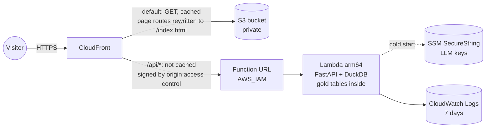

# Infrastructure

Terraform for the public demo on AWS, designed to run on always-free allowances
([ADR 0002](../docs/adr/0002-terraform-for-infrastructure.md),
[ADR 0003](../docs/adr/0003-serverless-hosting.md)).

```
infra/
  bootstrap/        one-time account setup: remote state bucket and a $1 cost budget (local state)
  app/              the demo itself (S3 remote state), wiring the two modules below
    tests/          offline tests with a mocked AWS provider
  modules/
    frontend/       private bucket, CloudFront distribution, origin access, security headers
    api/            Lambda function, Function URL, IAM role, log group, SSM parameters
  .tflint.hcl       lint rules for every stack
  check.sh          every check below, no AWS credentials needed
```

## How a request flows



- Both origins only answer CloudFront. The bucket policy allows `s3:GetObject` to this
  distribution only; the Function URL uses `AWS_IAM` auth and grants `lambda:InvokeFunctionUrl`
  and `lambda:InvokeFunction` to `cloudfront.amazonaws.com` for this distribution only.
- Because CloudFront signs requests to Lambda, a request with a body must carry its SHA-256 in
  `x-amz-content-sha256`. The dashboard computes it for `POST /api/ask`.
- The API reads the visitor address from `CloudFront-Viewer-Address` for its rate limits. It
  never sees the `Host` header or cookies.
- A CloudFront Function rewrites page routes (`/vehicle`) to `/index.html` on the default
  behavior only, so API errors such as a 404 reach the browser as JSON. There are no
  distribution-wide custom error pages for the same reason.
- Every response carries the same security headers as the local production preview
  (`frontend/security-headers.conf`), including a same-origin content security policy.

## Checks (local, free)

Every check runs in a Docker image pinned by digest, without AWS credentials, so it cannot
create or read anything in an AWS account. CI runs the same script.

```bash
bash infra/check.sh
```

| Check | What it catches |
|---|---|
| `terraform fmt -check` | formatting drift |
| `terraform validate` | syntax, types, provider schema (with `-backend=false`) |
| `terraform test` | design rules on a mocked provider: who may call each origin, routing, headers, logs, IAM, no keys in the Lambda environment |
| `tflint` | unused or undocumented declarations, naming, AWS rules such as invalid instance types |
| `trivy config` | security misconfigurations (public buckets, missing encryption, open policies) |

Findings that are accepted on purpose are ignored inline next to the resource, with the reason.
Each one is a paid feature the demo does without: WAF, access-log buckets, customer-managed KMS
keys, X-Ray, bucket versioning for files rebuilt from git.

Provider versions are locked in `.terraform.lock.hcl` for Linux, macOS and Windows. To upgrade:
change the version constraint, then run `terraform providers lock` with the same platforms.

## The API package (local, free)

The function is a zip for the `python3.13` runtime on arm64: the API, its dependencies and the
gold tables (about 29 MB zipped, 80 MB unpacked; the limits are 50 MB and 250 MB). It is built
and run locally before anything is deployed:

```bash
cd backend
.venv/Scripts/python -m serverless.build                    # -> backend/build/lambda/api.zip
docker compose --profile lambda up -d lambda-api            # official Lambda image, arm64
.venv/Scripts/python -m serverless.smoke                    # Function URL events, as CloudFront sends them
docker compose --profile lambda down
```

The build needs the gold tables (run the ETL first). On an x86 machine the arm64 container is
emulated, so its first request takes about 20 seconds; natively the cold start is about 1 second.

## Deploying (only after the checks pass and the plan is approved)

Nothing below is automated: each step is run by hand and its `plan` is read before `apply`.

### 1. Account hygiene (console, once)

1. Turn on MFA for the root user, and stop using root.
2. Create a non-root identity: an IAM Identity Center user with a permission set (free), then
   `aws configure sso` and `aws sso login`. No long-lived access keys on disk.
3. Check the account's plan (Free or Paid) and its creation date; the design relies only on
   always-free allowances, never on credits.
4. Check the Lambda concurrency quota (Service Quotas). With 1,000 or more, set
   `api_reserved_concurrency` (for example 5) to cap the API; with the low quota of some new
   accounts, AWS refuses any reservation, so leave it at -1.

### 2. Bootstrap (state bucket and budget)

```bash
cd infra/bootstrap
cp terraform.tfvars.example terraform.tfvars    # set budget_email
terraform init
terraform plan -out=bootstrap.tfplan            # read it
terraform apply bootstrap.tfplan
terraform output -raw backend_config > ../app/backend.hcl
```

Confirm the budget alert subscription in the email AWS sends. The state bucket has
`prevent_destroy`: removing it is a deliberate, manual act.

### 3. App

```bash
cd backend && .venv/Scripts/python -m serverless.build && cd ..   # the package Terraform uploads
cd infra/app
terraform init -backend-config=backend.hcl
terraform plan -out=app.tfplan                  # read it
terraform apply app.tfplan
```

The API starts with placeholder keys and answers the example questions offline. To connect the
hosted models, put each key in its parameter (names in `terraform output ssm_parameters`).
Terraform wrote the placeholder as a write-only value, so the real key never enters the state
and later applies do not overwrite it:

```bash
read -rs KEY && aws ssm put-parameter --name /autoinsights-prod/groq-api-key \
  --type SecureString --value "$KEY" --overwrite && unset KEY
```

Running instances read the keys at cold start, so new values apply as instances are replaced.

### 4. Dashboard upload

Hashed files under `assets/` are cached for a year; everything else is revalidated on each visit.

```bash
cd frontend && VITE_API_URL=/api npm run build
BUCKET=$(terraform -chdir=../infra/app output -raw frontend_bucket)
aws s3 sync dist/assets "s3://$BUCKET/assets" --cache-control "public, max-age=31536000, immutable"
aws s3 sync dist "s3://$BUCKET" --exclude "assets/*" --cache-control "no-cache" --delete
aws cloudfront create-invalidation --paths "/index.html" \
  --distribution-id "$(terraform -chdir=../infra/app output -raw distribution_id)"
```

Then open `terraform output url` and check `/api/health`.

### Removing the demo

```bash
cd infra/app
terraform plan -destroy -out=destroy.tfplan     # read it
terraform apply destroy.tfplan
```

This removes the distribution, the bucket (with its files), the function, its logs, role and
parameters. The bootstrap stays, so the state history is kept.

## Costs

Always-free allowances checked on 2026-11-14; check the AWS pricing pages again before deploying.

| Resource | Always-free allowance (per month) | Why it is $0 here |
|---|---|---|
| CloudFront | 1 TB out, 10M requests, 2M CloudFront Function invocations | demo traffic is far below |
| Lambda (arm64) | 1M requests, 400,000 GB-seconds | at 1 GB, 400,000 seconds of compute |
| CloudWatch Logs | 5 GB ingested and stored | one line per request, kept 7 days |
| SSM Parameter Store | standard parameters are free | two parameters; decrypting with the AWS managed key is within the KMS free requests |
| S3 (dashboard) | none after the first 12 months | a few MB: a fraction of a cent, rounded to $0.00 |
| S3 state bucket | per GB and request | a few KB, a handful of requests per apply |
| State locking | | S3 native lock file, no DynamoDB table |
| AWS Budgets | first two budgets free | one budget |
| Encryption | SSE-S3 and the AWS managed SSM key are free | no customer-managed KMS key |

Not used because they cost money even when idle: API Gateway, NAT gateways, load balancers,
WAF, Secrets Manager, custom domains (Route 53 hosted zone).
